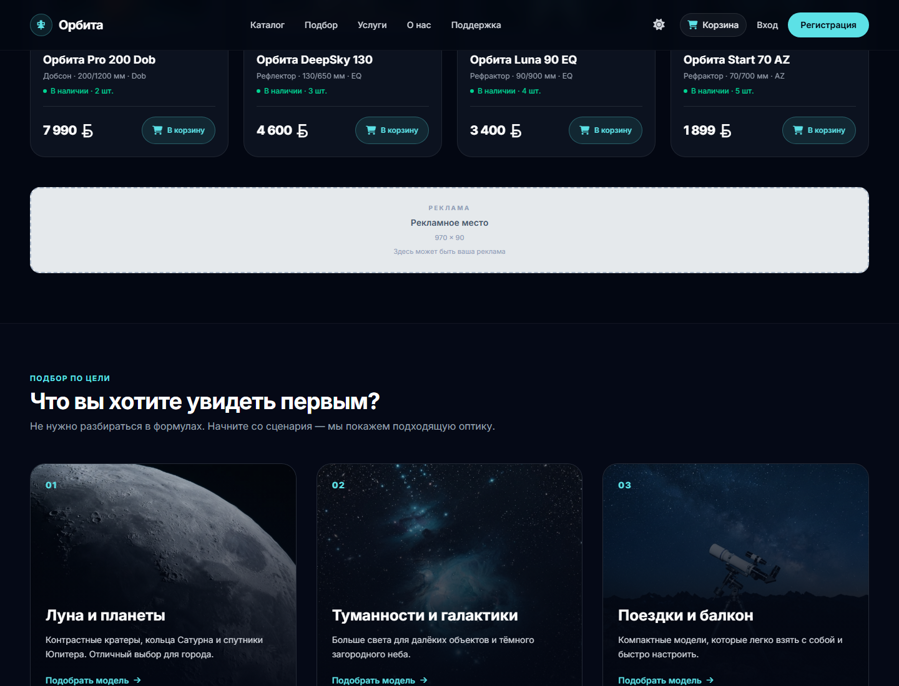
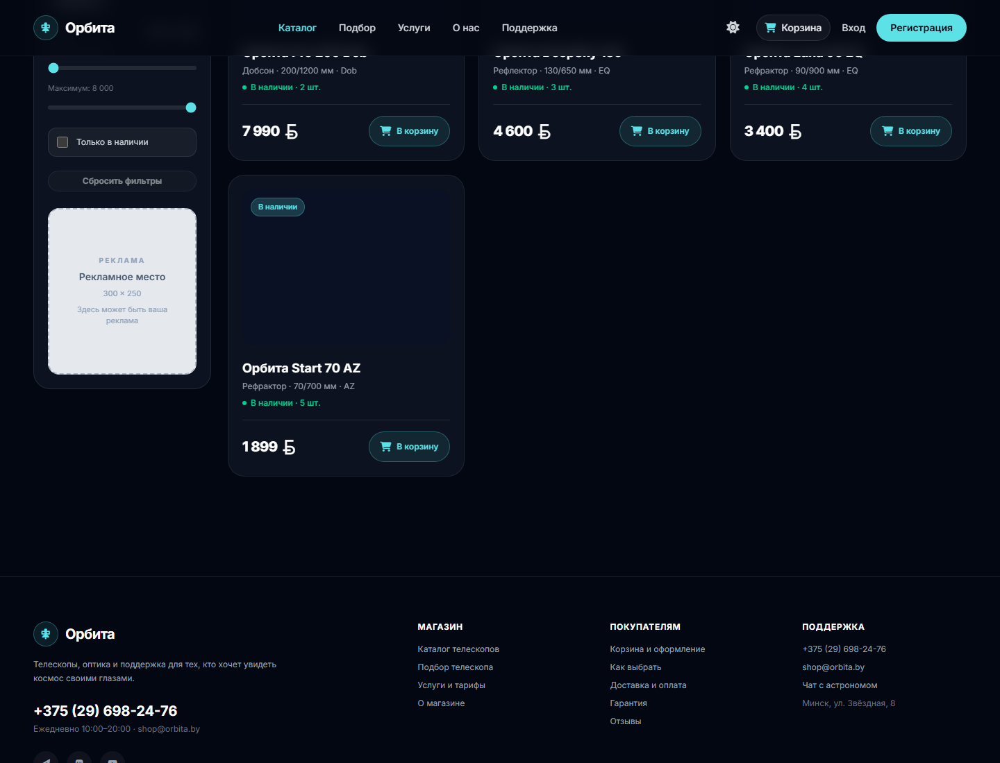

# Публикация сайта и сравнение бесплатных хостингов

## 1. Задание 1. Витрина «Орбита» на бесплатном хостинге

- **Платформа:** Cloudflare Pages (Free).
- **Адрес сайта:** <https://telescopeshop-5.pages.dev>.
- **Репозиторий:** <https://github.com/karrina867/telescopeShop_5>.
- **Настройки сборки:** root directory `frontend`, build command `npm run build`, output directory `dist`, переменная `NODE_VERSION=22`.

### 1.1. Почему Cloudflare Pages

Cloudflare Pages раздаёт статику с глобальной сети и не считает трафик: в документации сказано, что запросы к статическим файлам «free and unlimited» и на Free-, и на платных тарифах, поэтому витрина не упрётся в месячный лимит гигабайт. Free-план даёт 500 сборок в месяц, до 100 своих доменов и бесплатный TLS, а деплой запускается по push в GitHub. Для сайта с рекламным блоком это ещё и самый спокойный вариант по правилам: размещение рекламы не делает проект «коммерческим на личном тарифе», как на Vercel Hobby, и не подпадает под запрет коммерческих сайтов, действующий на GitHub Pages.

### 1.2. Что именно опубликовано

В production-сборке сайт работает без Laravel. Файл `src/api/http.js` подключает демо-адаптер (`src/api/demo.js` и `src/data/demoCatalog.js`) только при условии `import.meta.env.PROD && !VITE_API_URL`; в `npm run dev` запросы по-прежнему идут в реальный API. На опубликованной копии доступны каталог с фильтрами и сортировкой, подбор телескопа, корзина и оформление заказа: каталог берётся из демо-данных (4 товара, 3 категории), а корзина и заказы хранятся в `localStorage` (`orbita-cart`, `orbita-orders`). Вход в админ-панель на статической копии отключён, о чём страница `/login` предупреждает отдельной плашкой. Отдельный файл `_redirects` не нужен: Pages с пресетом Vite сам отдаёт `index.html` на внутренние маршруты, поэтому прямой заход на `/catalog` открывается без 404.

### 1.3. Компонент `AdSlot.vue`

Компонент принимает пресет `size` (`banner`, `sidebar`, `inline`), подпись `label` и необязательные `width`/`height` в пикселях или в любых CSS-единицах. Светлая поверхность и пунктирная рамка заданы буквально (`bg-slate-100/95`, `border-slate-400/70`), поэтому в тёмной теме блок намеренно контрастирует с фоном и сразу заметен. Размер по умолчанию и подсказка выводятся текстом, а `role="note"` и `aria-label` делают плейсхолдер доступным для скринридеров.

```vue
<script setup>
const props = defineProps({
  size: {
    type: String,
    default: 'banner',
    validator: (value) => ['banner', 'sidebar', 'inline'].includes(value),
  },
  label: { type: String, default: 'Рекламное место' },
  hint: { type: String, default: 'Здесь может быть ваша реклама' },
  width: { type: [Number, String], default: null },
  height: { type: [Number, String], default: null },
})

const PRESETS = {
  banner: { box: 'min-h-24 px-6 py-6 sm:min-h-28', dimensions: '970 × 90' },
  sidebar: { box: 'min-h-60 px-5 py-6', dimensions: '300 × 250' },
  inline: { box: 'min-h-28 px-5 py-6', dimensions: '728 × 90' },
}

// preset, dimensions и customSize — computed-значения из этих пропсов:
// они выбирают классы пресета, подпись размера и inline-стили для width/height.
</script>

<template>
  <div
    class="ad-slot flex w-full max-w-full flex-col items-center justify-center gap-1.5 rounded-card border-2 border-dashed border-slate-400/70 bg-slate-100/95 text-center"
    :class="preset.box"
    :style="customSize"
    role="note"
    :aria-label="label"
  >
    <span class="text-[10px] font-bold uppercase tracking-[0.22em] text-slate-400">Реклама</span>
    <span class="text-sm font-semibold text-slate-600">{{ label }}</span>
    <span class="text-[11px] font-medium text-slate-400">{{ dimensions }}</span>
    <span class="text-[11px] text-slate-400">{{ hint }}</span>
  </div>
</template>
```

### 1.4. Размещение и скриншоты

Баннер `banner` стоит на главной сразу под подборкой популярных телескопов, а `sidebar` — в каталоге под панелью фильтров; на узких экранах боковой блок скрыт (`hidden lg:block`), потому что в мобильном фильтры открываются в выдвижном ящике. Скриншоты production-сборки на 1440 px:





## 2. Задание 2. Сравнение платформ

### 2.1. Сводная таблица

| Платформа | Трафик на Free | Сборки | Коммерческое использование | Реклама | Домен и SSL | Git-деплой | Когда подходит |
| --- | --- | --- | --- | --- | --- | --- | --- |
| **Cloudflare Pages** | Статика бесплатна и без лимита [1] | 500 сборок/мес, 1 одновременно [2] | Не запрещено; ограничения касаются незаконного контента и данных карт на Free [3] | Отдельного запрета нет [3] | `*.pages.dev` + до 100 своих доменов с TLS [2] | GitHub/GitLab, сборка по push [4] | Витрина, лендинг, высокий трафик |
| **GitHub Pages** | 100 ГБ/мес, «soft»-лимит [5] | 10 сборок/час; Actions — без этого лимита [5] | Запрещено для интернет-магазинов и сайтов, нацеленных на сделки [5] | Умеренная реклама допустима, но не как основной фокус сайта [6] | Свой домен + TLS Let's Encrypt [7] | GitHub Actions или ветка `gh-pages` [7] | Документация, портфолио, пет-проекты |
| **Netlify (Free)** | 300 кредитов/мес; 20 кредитов за 1 ГБ, то есть ≈15 ГБ [8] | 15 кредитов за production-деплой [8] | В ToS прямо не закреплено; AUP разрешает хостить сайты клиентов [9] | Не запрещена, запрещён спам [9] | Свой домен + TLS на Free [8] | Git-интеграция и preview-деплои [8] | Небольшие сайты с формами и превью |
| **Vercel (Hobby)** | 100 ГБ Fast Data Transfer [10] | 100 деплоев в день [10] | Только личное или некоммерческое использование [11] | Не оговорена, но монетизация равна коммерческому использованию [11] | Свой домен + автоматический TLS [10] | Git-интеграция [10] | Личные проекты и портфолио |
| **Render (Free)** | 5 ГБ/мес outbound, далее $0,15 за ГБ [12] | Ограничены pipeline-минутами тарифа [12][13] | Бесплатные инстансы не предназначены для production [13] | Отдельных правил нет [13] | Свой домен + managed TLS [13] | Git auto-deploy [13] | Прототипы и тестовые сборки |

Источники: [1] [Cloudflare Pages — Pricing](https://developers.cloudflare.com/pages/functions/pricing/) («requests to static assets are free and unlimited»); [2] [Cloudflare Pages — Limits](https://developers.cloudflare.com/pages/platform/limits/); [3] [Cloudflare Self-Serve Subscription Agreement](https://www.cloudflare.com/terms/), § 2.2.1(h) и § 2.7; [4] [Cloudflare Pages — Git integration](https://developers.cloudflare.com/pages/get-started/git-integration/); [5] [GitHub Pages limits](https://docs.github.com/en/pages/getting-started-with-github-pages/github-pages-limits); [6] [GitHub Acceptable Use Policies, § 10](https://docs.github.com/en/site-policy/acceptable-use-policies/github-acceptable-use-policies); [7] [GitHub Pages — custom domains](https://docs.github.com/en/pages/configuring-a-custom-domain-for-your-github-pages-site); [8] [Netlify Pricing](https://www.netlify.com/pricing/); [9] [Netlify Acceptable Use Policy](https://www.netlify.com/legal/acceptable-use-policy/), [Terms of Use](https://www.netlify.com/legal/terms-of-use/); [10] [Vercel Hobby Plan](https://vercel.com/docs/plans/hobby); [11] [Vercel Terms of Service, § 4](https://vercel.com/legal/terms#hobby-plan); [12] [Render — Outbound Bandwidth](https://render.com/docs/outbound-bandwidth); [13] [Render — Deploy for Free](https://render.com/docs/free).

### 2.2. Предупреждение о рисках политики

Самый рискованный вариант для интернет-магазина — GitHub Pages. В разделе лимитов прямо сказано: сервис «not intended for or allowed to be used as a free web-hosting service to run your online business, e-commerce site, or any other website that is primarily directed at either facilitating commercial transactions». То есть витрина с корзиной и оформлением заказа уже нарушает это правило, даже если платежи не подключены. Второй риск описан в Acceptable Use Policies, § 10: реклама не запрещена полностью, но «the primary focus of the Content posted in or through your Account to the Service should not be advertising or promotional marketing», и это правило распространяется в том числе на Pages. Если рекламные блоки станут главным содержимым страницы, сайт могут снять; сочетание «магазин + реклама как основной контент» — худший сценарий для этой платформы.

Vercel Hobby отпадает по другой причине: § 4 Terms of Service говорит, что Hobby можно использовать «only … for your personal or non-commercial use», а витрина магазина с рекламой — это коммерческое использование. Нарушение грозит приостановкой проекта без предупреждения, поэтому Hobby годится только для личной демонстрации портфолио.

У Netlify формулировки мягче, но менее определённые: Acceptable Use Policy не запрещает ни рекламу, ни коммерческие сайты, а § 4 разрешает хостить сайты третьих лиц. При этом в Terms of Use статус бесплатного тарифа для бизнеса отдельно не зафиксирован, поэтому опираться стоит на письменный ответ поддержки, а не на общее впечатление от документации.

У Cloudflare Pages запрета на рекламу нет: § 2.7 Self-Serve Subscription Agreement перечисляет только незаконный контент, вредоносный код, фишинг и спам. Но есть важный нюанс для магазина: § 2.2.1(h) запрещает «process or collect personal or business credit card information on any web property that is receiving Free Services». Поэтому опубликованная копия должна оставаться витриной без реального приёма карт — в нашем демо оформление заказа ничего не списывает и не запрашивает платёжные данные. Если появятся настоящие платежи, их нужно выносить на сторону платёжного провайдера, а не собирать данные карты на бесплатном домене. Рекламные сети вроде Google AdSense проходят собственную модерацию и требуют политики конфиденциальности; статичный плейсхолдер без сторонних скриптов таких требований не создаёт.

### 2.3. Рекомендация

Для этой публикации выбраны Cloudflare Pages: у платформы нет лимита на статический трафик, нет запрета на рекламу и коммерческое использование, а бесплатный TLS и деплой по push настраиваются за пару минут. 500 сборок в месяц с запасом покрывают учебный проект, а внутренние маршруты SPA открываются по прямой ссылке без дополнительных настроек. GitHub Pages и Vercel Hobby подходят только для личной демонстрации, поскольку их правила прямо ограничивают магазины и коммерческую монетизацию. Netlify можно рассматривать как запасной вариант, если понадобятся формы и preview-деплои, но перед коммерческим запуском стоит получить письменное подтверждение условий. Render на Free хорош для прототипов, однако 5 ГБ трафика в месяц для витрины слишком мало.

### 2.4. Факторы решения

1. **Потолок бесплатного тарифа.** Сначала сравниваются лимиты трафика и сборок: безлимитная статика Cloudflare выигрывает у 100 ГБ GitHub Pages, 100 ГБ Vercel и особенно у 5 ГБ Render, где превышение уже тарифицируется.
2. **Правовой статус проекта.** Коммерческая витрина с рекламой отсекает Vercel Hobby (только личное использование) и GitHub Pages (запрет e-commerce), а у Netlify условия приходится уточнять у поддержки.
3. **Удобство эксплуатации.** Git-деплой по push, откат к предыдущей сборке, бесплатный домен с TLS и корректная работа прямых ссылок одинаково важны, потому что сайт должен обновляться без ручной загрузки файлов и открываться по любому внутреннему адресу.
